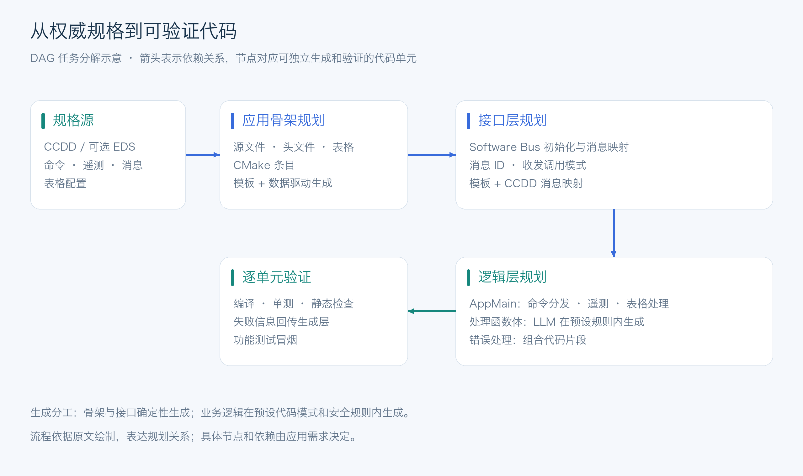
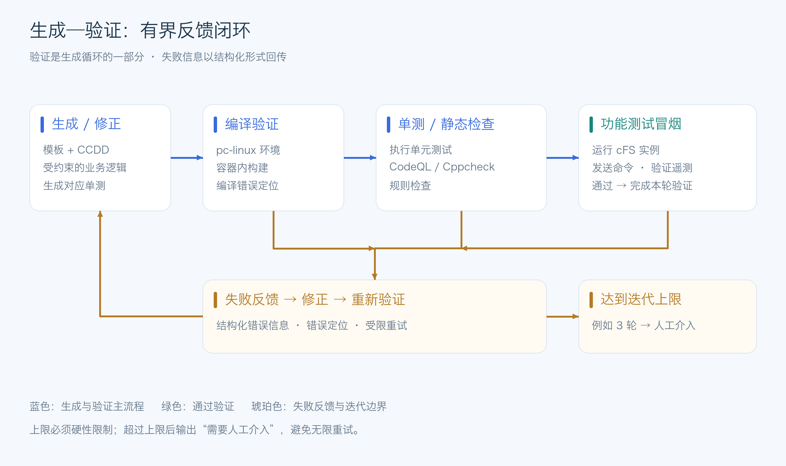
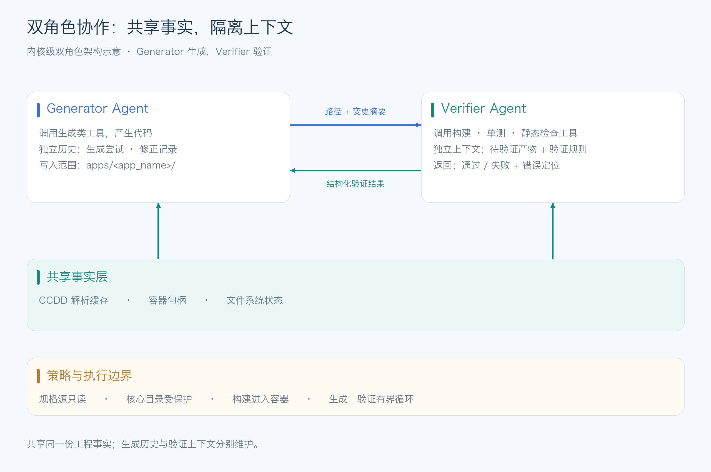

# cFS Agent 工程构想

文档 渐进式披露

## 一、不错的参考规范

- **cFS 已有成熟的“先模型、后代码”范式**。F Prime 的 FPP 模型 autocode 出 C++ 基类，开发者只实现 handler，这个模式在航天嵌入式领域已经被验证是 AI agent 友好的。cFS 虽然没有 FPP 那样统一的建模语言，但 CCDD 实际上承担了同样的角色：它是命令、遥测、消息结构的“权威来源”。
- **CCDD 导出或直接解析**。CCDD 已经定义了每个 cFS 应用的命令、遥测、消息结构、表格配置。agent 可以读取 CCDD 的 JSON/XML 导出，把它作为“唯一真相源”。
- **可选：EDS（Electronic Data Sheet）**。cFS 生态中已有 EDS 工具链，可以生成 C 结构体、Python 绑定和测试框架。agent 可以同时支持 CCDD 和 EDS 两种规格源。

## 二、DAG 规划

不要用一个巨型 prompt 一次性生成整个应用。cFS 应用的结构高度模板化，规划层应该做 **任务分解**：

- **应用骨架规划**：根据 CCDD 中该应用的消息接口，决定需要哪些源文件、头文件、表格定义和 CMake 条目。cFS 已有的 “Generate Application Template Tool” 生成的骨架可以作为基线。
- **接口层规划**：从 CCDD 的消息定义映射到 cFE 的 SB（Software Bus）接口、消息 ID 分配和 `CFE_SB_TransmitBuffer`/`CFE_SB_ReceiveBuffer` 调用模式。
- **逻辑层规划**：把行为需求分解为 `AppMain` 循环中的命令分发、遥测更新和表格处理片段。

规划层可以是一个轻量的 **DAG**（有向无环图），每个节点对应一个可独立生成和验证的代码单元。这与 x2harness 中“Spec-to-DAG 拓扑波次求解器”的思路一致。



*图 1 · 规格、骨架、接口、逻辑与验证之间的依赖关系。*

## 三、模板 + 填充

| 代码部分 | 生成方式 |
| --- | --- |
| 应用骨架、`CMakeLists.txt`、表格定义 | 模板 + CCDD 数据驱动，**确定性生成** |
| SB 接口初始化、消息收发调用 | 模板 + CCDD 消息映射，**确定性生成** |
| 命令分发 `switch` 骨架 | 模板 + CCDD 命令列表，**确定性生成** |
| 命令处理函数体中的业务逻辑 | **LLM 生成**，但必须受限于预设的代码模式和安全规则 |
| 错误处理、事件上报、遥测更新 | 提供可组合的代码片段库，LLM 选择并填入参数 |

## 四、验证

cFS 生态的 CI 已经非常成熟：GitHub Actions 上会跑单元测试、功能测试、CodeQL、Cppcheck 和格式检查。你的 agent 必须把这条流水线作为 **生成循环的一部分**，而不是事后检查： [参考 1][ref-1]

1. **编译验证**：生成代码后立即在 cFS 的 pc-linux 构建环境中编译（cFS 官方支持在 Linux 上构建和运行）。

2. **单元测试生成 + 执行**：cFS 使用 `ENABLE_UNIT_TESTS=true` 构建，可以用 `make test` 运行单元测试。agent 可以 **同时生成针对该命令处理函数的单元测试桩**，然后运行，根据失败信息修正。 [参考 1][ref-1]

3. **静态分析门禁**：cFS CI 中包含 CodeQL 和 Cppcheck，并关注 MISRA 相关规则。agent 的生成结果必须通过同一套静态检查，否则触发修正循环。 [参考 1][ref-1]

4. **功能测试冒烟**：cFS 有 `cfe_testcase` 功能测试应用，可以在 live cFS 实例上运行。agent 可以生成简单的外部脚本（通过 CI Lab / TO Lab 的 UDP 接口）发送命令并验证遥测。 [参考 2][ref-2] [参考 1][ref-1]

**验证闭环的逻辑**：生成 → 编译 → 单测/静态检查 → 失败则把错误信息结构化地回传给规划/生成层 → 修正 → 重新验证。这个循环的最大迭代次数应硬性限制（例如 3 轮），超过则标记为“需要人工介入”，而不是无限重试。



*图 2 · 验证失败后回传错误并修正；达到迭代上限后转为人工介入。*

## 五、巨人的肩膀

Pi 是一个 MIT 协议的 TypeScript monorepo，核心设计非常克制：系统提示词和工具定义加起来不到 1000 tokens，**内置工具只有 read / bash / edit / write**，没有内置的 plan mode、sub-agents、MCP、权限弹窗。Pi 提供了完整的 **Extension 机制**。

**cFS 的能力封装成 Pi 可调用的工具**，通过 `pi.registerTool()` 注册进去。这样你的项目本质上是一个 **“cFS Extension Pack”**，而不是一个 fork，后续跟进 Pi 上游更新会容易得多。

需要注册的 cFS 领域工具，建议按“**模型 → 生成 → 验证**”三层来组织，对应你第一轮提到的 cFS 工程范式：

### 用事件拦截实现 cFS 安全约束

Pi 的 Extension 支持 `pi.on("tool_call", ...)` 拦截工具调用。你可以利用这一点，在 Agent 层面加一道 **cFS 专属门禁**：

- **禁止直接修改 CCDD 文件**：CCDD 是权威来源，Agent 只能读取和解析，不能写入。如果 LLM 试图 `write` 或 `edit` CCDD，直接 block。

- **禁止触碰 cFE / OSAL / PSP 核心**：Agent 的活动范围严格限制在 Mission Tree 的 `apps/` 目录下，对 cFE 核心的修改请求直接拒绝。

- **强制走模板生成**：如果 LLM 试图绕过 `gen_cfs_skeleton` 直接手写应用骨架，拦截并提示“请先调用骨架生成工具”。

这些约束不需要写进 system prompt 反复强调，而是**在代码层面硬性执行**，这对星务软件的可认证性至关重要。

### 利用 sub-agents 做“生成-验证”分离

Pi 本身没有内置 sub-agents，但社区扩展（如 `pi-subagents`、`pi-agents-flow`）已经提供了成熟的模式。对于 cFS 场景，建议至少拆出两个角色： [参考 3][ref-3] [参考 4][ref-4]

- **Generator Agent**：负责调用生成类工具，产生代码。

- **Verifier Agent**：负责调用构建、单测、静态检查工具，只返回通过/失败及结构化错误信息。

Generator 拿到 Verifier 的失败反馈后进行修正，形成**有界循环**（比如最多 3 轮）。这种分离的好处是：验证逻辑不会被生成逻辑“污染”，而且 Verifier 的上下文可以保持干净，只关注错误信号。

### 两个需要留意的坑

**第一，Pi 的“极简”是有代价的。** 它没有内置 plan mode 和 todo 系统，意味着你的 cFS 工作流编排（先解析、再生成、再验证）需要自己用 Extension 的状态管理或 sub-agent 的 prompt 来实现。好在 cFS 的流程本身高度固定，用 Extension 里的简单状态机就够了，不需要引入通用 plan mode 的复杂度。

**第二，cFS 的构建环境必须 Docker 化。** Pi 的 `bash` 工具默认在宿主机执行，但 cFS 的构建依赖特定的工具链和目录结构。把你的 `cfs_build` 和 `cfs_unittest` 工具实现为 **Docker 容器内的命令**，这样 Agent 的生成环境与验证环境严格隔离，也符合 Pi “把沙箱交给容器”的设计取向。

### 内核强约束

Pi 的内核是一个极简的 Agent Loop，主干是：**装配上下文 → 请求模型 → 执行工具 → 写回历史 → 判断是否再来一轮**。在不改内核时，你只能用 prompt 或 Extension 去“劝说”模型按 cFS 的流程走；改内核后，你可以**在循环层面强制执行领域约束**。 [参考 5][ref-5]

#### 1. 把 cFS 工作流“焊死”进 Agent Loop

具体可以做的：

- **强制前置条件**：在 `gen_cmd_handler` 之前，内核层校验是否已经调用过 `parse_ccdd` 和 `gen_cfs_skeleton`。不满足则不允许进入下一轮，而不是靠 prompt 提示。这消除了 LLM“跳过规格直接手写代码”的可能性。

- **硬性迭代上限**：cFS 的生成-验证闭环必须有界。内核层设置 `maxGenerationRetries`，超过后强制终止并输出“需要人工介入”的结构化信号，而不是让 Agent 无限重试。 [参考 6][ref-6]

- **工具调用的领域调度**：将工具分为“读类”（`parse_ccdd`、`read`）和“写类”（`gen_*`、`write`、`edit`），内核层限制**写类工具只能在读类工具成功返回后调用**。这是 Extension 的 `tool_call` 拦截做不到的——拦截只能阻止单次调用，无法表达跨轮次的状态依赖。

这本质上是把 cFS 的**工程门禁从外部 CI 前移到 Agent Loop 内部**，让不合规的生成路径在循环中途就被掐断。

#### 2. 将领域模型注入上下文装配层

Pi 的上下文装配是内核的核心环节之一。默认情况下，上下文由会话历史和当前工具结果拼装而成。改内核后，你可以**在装配阶段自动注入 cFS 的领域约束，而不是依赖 LLM 每次都去“记得”这些约束**。

| 注入内容 | 作用 |
| --- | --- |
| **CCDD 接口签名摘要** | 每次请求模型前，自动把当前应用的 CCDD 接口定义压缩后注入 system 上下文，确保 LLM 始终基于权威接口工作，而不是从历史中“回忆” |
| **cFS 编码规则片段** | 把 SB 收发模式、事件上报格式、表格访问方式等 cFS 惯用法作为**不可被压缩的固定上下文**注入，避免长会话中被摘要丢失 |
| **当前应用的依赖图** | 如果该应用依赖其他应用的消息接口，在内核层注入依赖应用的接口摘要，让 LLM 在做修改时感知跨应用影响 |

Pi 已有 `pi-context-diet` 这类 Extension 做上下文裁剪，但它的裁剪策略是通用的。改内核后，你可以实现**领域感知的上下文生命周期**：CCDD 摘要和编码规则永远不被裁剪，工具调用的中间产物按任务阶段自动淘汰。这是 Extension 无法做到的，因为 Extension 只能“追加”内容，无法控制内核装配上下文时的保留优先级

#### 3. 安全模型从“外层沙箱”下沉到内核原生

Pi 的安全哲学很明确：**信任边界就是启动它的那个用户账号，真正的隔离是用户的责任，不是 Pi 的功能**。在不改内核时，你只能靠 Docker 外层包裹。改内核后，你可以把 cFS 的安全约束做成**内核原生的执行策略**：

- **路径级写权限矩阵**：内核在工具执行前，基于**任务角色**判断写权限。例如，Generator Agent 只能写入 `apps/<app_name>/`，Verifier Agent 只能读取和运行构建命令，两者共享同一个内核但拥有不同的能力位。这比在 Extension 里写 `tool_call` 拦截更细粒度，因为拦截发生在工具执行之后，而内核级策略发生在**工具调用被构造之前**。

- **危险操作的“不可能性”**：对于 cFE 核心、OSAL、PSP 目录，以及 CCDD 文件的写操作，在内核层直接将该路径从可写集合中**物理移除**，而不是在运行时拦截并返回 `block: true`。前者是“能力缺失”，后者是“策略拒绝”——前者在可认证性论证中更干净。

- **构建环境的强制路由**：所有 `bash` 类调用，如果匹配 cFS 构建/测试模式，内核层强制重写为**容器内执行**的命令，而不是依赖 LLM 自觉加上 `docker exec` 前缀。

Pi 社区已经在讨论“内核级 OS 沙箱”的方向，你的 cFS 场景恰好提供了一个**领域策略明确、边界天然清晰**的落地用例。 [参考 7][ref-7]

#### 4. 为 cFS 定制工具调度的缓存策略

cFS 开发的工作流有很强的**重复性和局部性**：同一个应用的多轮生成-验证循环中，CCDD 解析结果、骨架模板、构建环境状态都是高度稳定的。Pi 社区已经有 `pi-condense` 和 `pi-context-diet` 在缓存冷热边界上做优化，但它们的策略是通用的。改内核后，你可以做**领域预热的缓存调度**： [参考 8][ref-8]

- 在会话启动时，**预解析当前 Mission Tree 中所有应用的 CCDD**，将接口 IR 放入进程内缓存，后续所有工具调用直接复用，消除重复解析开销。

- 对 `gen_cfs_skeleton` 这类**确定性生成**，内核层可以基于输入 IR 的哈希做**结果缓存**：如果 CCDD 没变，骨架生成直接返回缓存结果，跳过工具执行。这在多轮修正循环中能显著降低延迟。

- 将构建环境的**容器热状态**纳入内核调度：`cfs_build` 首次调用启动容器，后续调用复用同一容器实例，避免每次构建都付出冷启动成本。Pi 内核的调度器已经支持会话级的状态保持，你可以把容器句柄作为内核级资源来管理。

#### 5. 让“生成者”和“验证者”共享内核但隔离上下文

Extension 做 sub-agents 时，子会话是独立的。但改内核后，你可以实现**共享内核状态、隔离对话历史**的双角色架构：

- **共享的部分**：CCDD 解析缓存、容器句柄、文件系统状态——这些是“事实层”，两个角色看到完全一致。

- **隔离的部分**：Generator 的对话历史包含大量生成尝试和失败记录，Verifier 不需要看到这些“噪音”，它只需要收到**结构化的待验证产物**（文件路径 + 变更摘要）和**验证规则**，返回**结构化的通过/失败信号 + 错误定位**。

这种架构的关键优势在于**验证器的判断不会被生成器的“自我辩解”污染**。Extension 层面的 sub-agent 虽然能隔离会话，但工具注册表和缓存是独立的；内核级双角色可以做到“看到同一份事实，但用不同的认知框架去处理”。

Pi 的 Session Backend 已经是 SQLite 持久化的，内核层完全有能力承载这种**多角色共享后端、隔离前端**的会话模型。



*图 3 · 双角色共享工程事实，并分别维护生成历史与验证上下文。*

### 优先级建议：先改“约束层”，再改“优化层”

如果只能改内核做一件事，**优先做进阶一（Agent Loop 的领域约束）**。它直接解决 cFS 场景最核心的痛点——**生成路径的合规性不能依赖 LLM 的自觉**。进阶二和三紧随其后，因为它们决定了 Agent 能否在不牺牲安全边界的前提下扩展能力边界。进阶四和五属于效率和多角色协作层面，在窄闭环跑通后再做。

改内核的代价是**上游合并成本**，所以建议把内核修改控制在**策略层**（约束、注入、调度），而不是侵入核心控制流（流式处理、 Provider 适配）。Pi 的分层架构本身就是为了让“策略”和“机制”分离，你的 cFS 领域策略应该尽量落在 `pi-coding-agent` 这一层，而不是深入 `pi-agent-core` 的循环机制。这样即使 Pi 上游演进，你的领域改造也只需要适配策略接口，而不是重写循环。

---

## 参考资料

1. [cFS 测试指南][ref-1]
2. [cFS 演示文稿][ref-2]
3. [Pi sub-agents 扩展（rhinos0608）][ref-3]
4. [Pi sub-agents 扩展（cheetahbyte）][ref-4]
5. [Agent Loop 相关资料][ref-5]
6. [Cloudflare Agents 发布记录][ref-6]
7. [Pi Sandbox 扩展][ref-7]
8. [Pi Condense 扩展][ref-8]

[ref-1]: https://thedocumentation.org/cfs/guides/testing/
[ref-2]: https://gotyto.com/wp-content/uploads/cFS-deck.pdf#12#13#12
[ref-3]: https://pi.dev/packages/@rhinos0608/pi-subagents?name=sub+agents&page=3
[ref-4]: https://pi.dev/packages/@cheetahbyte/pi-subagents?page=109
[ref-5]: https://m.163.com/dy/article/LAG3NRBL0511805E.html?spss=adap_pc#1
[ref-6]: https://newreleases.io/project/github/cloudflare/agents/release/agents@0.33.0#1
[ref-7]: https://pi.dev/packages/@yandy0725/pi-sandbox?name=plan&page=2
[ref-8]: https://pi.dev/packages/@yofriadi/pi-condense?page=85


-----------
## 一、先修正几个关键技术判断

### 1. CCDD 不等于 FPP

你提出的 Model-First 思路是对的，但有一个地方需要严格区分。

|对比|F Prime|cFS|
|---|---|---|
|模型|FPP|CCDD / EDS / 需求模型|
|模型语义分析|FPP Compiler|需要自己实现或集成|
|代码生成|FPP Autocoder|cFS 模板生成 + 自定义 Codegen|
|接口约束|FPP 类型和端口系统|CCDD / EDS + cFE 接口规则|
|业务实现|Handler|cFS App 业务逻辑|

CCDD 可以提供很多接口元数据，但不能默认认为每个 cFS Mission 都有一份完整、最新且覆盖所有应用的 CCDD 数据库。

因此，我建议定义一个统一的规格抽象层：

```
        CCDD Parser          EDS Parser
             |                   |
             v                   v
        +---------------------------+
        |     CFS Specification IR  |
        +---------------------------+
                     |
                     v
              Semantic Validator
                     |
                     v
                Task Planner
```

IR 至少需要包含：

- Application
    
- Command
    
- Telemetry
    
- Message
    
- Data Type
    
- Table
    
- Event
    
- Message ID
    
- Dependency
    
- Requirement Traceability
    

还应该有来源追踪：

```
interface SpecElement {
  id: string;
  name: string;
  source: {
    type: "ccdd" | "eds" | "requirement";
    file: string;
    location?: string;
  };
}
```

这样生成代码后，可以追溯它来自哪一条规格定义。

我的建议：先做 CCDD Adapter + IR，不要一开始就做 CCDD 和 EDS 的双向转换。

### 2. DAG 规划是对的，但不要让 LLM 自己决定全部依赖关系

你提到的 DAG 很适合 cFS。

不过，建议区分两种节点：

- 结构性节点：由规则引擎确定。
    
- 语义性节点：由 LLM 根据需求分析产生。
    

例如：

温度采集应用的开发 DAG

Specification Analysis

Command Definition

Telemetry Definition

Command Skeleton

Telemetry Skeleton

Business Logic Implementation

LLM 实现采集、阈值判断、状态管理

Build + Unit Test + Static Analysis

Validated Application

比如，Command Definition 和 Telemetry Definition 可以并行处理，但生成代码前必须确保它们使用的消息类型和接口定义已经确定。

DAG 节点最好有统一的数据结构：

```
interface TaskNode {
  id: string;
  type: string;
  dependencies: string[];

  input: Record<string, unknown>;
  output?: Record<string, unknown>;

  status:
    | "pending"
    | "running"
    | "success"
    | "failed";

  retryCount: number;
}
```

这样 DAG 不只是一个 Prompt 中的计划，而是可以被 Extension 真正执行、持久化和恢复的工作流。

### 3. 模板 + LLM 混合生成，是正确的核心策略

我非常赞同你第三部分。

我会进一步把生成器分成三类：

|生成类型|方式|是否允许 LLM 自由修改|
|---|---|---|
|应用目录、CMake、基础文件|模板生成|否|
|SB 初始化、命令分发、遥测结构|IR 驱动 Codegen|否|
|业务逻辑|LLM 生成|有约束|
|错误处理、事件、表格访问|受控代码片段|有约束|

特别是你提到的 `CFE_SB_TransmitBuffer`、`CFE_SB_ReceiveBuffer`，不要仅凭名称生成调用。

要先读取目标 cFS 版本的头文件、API 声明和示例代码，确定实际使用的接口、缓冲区生命周期和错误处理方式。

另外，生成代码最好分成：

```
generated/
    自动生成，不允许手改

user/
    LLM 和开发者实现

interface/
    规格和接口定义
```

实际 cFS 应用未必天然采用这种目录结构，但可以通过生成标记、独立文件和模板约定实现类似的所有权隔离。

这可以显著减少多轮生成时覆盖用户代码的问题。

## 二、Pi Extension 实际上能做的比你设想的更多

这是整份方案中我最想纠正的地方。

你写道：

> Extension 只能阻止单次工具调用，无法表达跨轮次的状态依赖。

这个判断不准确。

根据 Pi 当前的官方 Extension API，已经提供了足够多的机制来实现你的工作流。

### 1. `tool_call`：工具执行前的拦截

执行顺序是：

```
LLM 产生 Tool Call
       |
       v
tool_execution_start
       |
       v
tool_call
       |
       +---- block? ----> 返回拒绝结果
       |
       v
执行 Tool
       |
       v
tool_result
       |
       v
tool_execution_end
```

注意：`tool_call` 是在工具执行之前触发的，不是在执行之后。

它能够：

- 阻止 `write` 修改 CCDD。
    
- 阻止 `edit` 修改 cFE 核心。
    
- 检查调用 `gen_cmd_handler` 前是否完成规格解析。
    
- 阻止未经授权的工具调用。
    
- 修改工具参数。
    

参考：[Pi Extension Tool Events](https://pi.dev/docs/latest/extensions?utm_source=chatgpt.com)。

Pi

### 2. Extension 可以维护跨轮次状态

这恰恰是你需要的能力。

例如：

```
interface CFSWorkflowState {
  specParsed: boolean;
  skeletonGenerated: boolean;
  generated: boolean;
  verificationPassed: boolean;

  retryCount: number;
  maxRetries: number;
}
```

Extension 维护这个状态：

```
用户提出需求
     |
     v
specParsed = false
     |
     v
parse_ccdd 成功
     |
     v
specParsed = true
     |
     v
gen_cfs_skeleton
     |
     v
skeletonGenerated = true
     |
     v
gen_cmd_handler
```

在 `tool_call` 中检查状态：

```
pi.on("tool_call", async (event, ctx) => {
  if (
    event.toolName === "gen_cmd_handler" &&
    !state.specParsed
  ) {
    return {
      block: true,
      reason: "Please parse CCDD first."
    };
  }

  if (
    event.toolName === "gen_cmd_handler" &&
    !state.skeletonGenerated
  ) {
    return {
      block: true,
      reason: "Please generate application skeleton first."
    };
  }
});
```

这只是示意代码，实际还需要处理任务切换、失败回滚、并行工具调用和会话恢复。

Pi 还支持 `pi.appendEntry()` 保存 Extension 状态，能够在会话恢复时重建状态。官方文档也建议按照当前会话分支恢复状态，而不是只依赖内存变量。

Pi

因此，不需要为了跨轮次状态依赖去修改 Agent Loop。

有一个细节需要注意：同一条 Assistant 消息中并行发出的工具调用，不能假设前一个工具已经执行成功。你的 DAG 执行器应该明确控制依赖节点的调度，不能只靠 `tool_call` 的触发顺序。

### 3. Extension 可以控制上下文，不只是追加 Prompt

你原文中还有一个判断：

> Extension 无法控制内核装配上下文时的保留优先级。

这个说法也过于绝对。

Pi 提供了：

|Hook|能力|
|---|---|
|`before_agent_start`|注入当前任务的领域上下文|
|`context`|修改本次模型请求使用的消息|
|`context_with_system`|修改包含 System Prompt 的上下文|
|`session_before_compact`|自定义压缩前的摘要|
|`agent_before_settle`|在 Agent 结束前追加信息或要求继续执行|

参考：[Pi Extensions](https://pi.dev/docs/latest/extensions?utm_source=chatgpt.com)、[Pi Compaction](https://pi.dev/docs/latest/compaction?utm_source=chatgpt.com)。

Pi+1

所以你可以实现：

```
每次模型请求
     |
     v
读取当前任务状态
     |
     v
获取 CCDD IR 摘要
     |
     v
获取相关 API 约束
     |
     v
获取当前 DAG 节点
     |
     v
注入模型上下文
     |
     v
LLM
```

上下文压缩时，再把关键工程事实写入自定义摘要。

这比修改 Pi 的上下文装配内核更合适。

## 三、我会把安全架构重新设计一下

你提出的安全约束非常重要，但有必要区分两种安全：

- Agent 工作流约束。
    
- 操作系统级安全隔离。
    

Extension 的 `tool_call` 可以实现前者，不能单独保证后者。

例如，拦截 `write` 修改 `cFE/`，并不能阻止模型通过 `bash` 调用其他程序修改它。

而且 Pi Extension 和 Pi 本身运行在相同的操作系统权限下。官方文档明确提醒这一点。

Pi

建议：

安全控制分层

第一层：Pi Extension Policy

- 拦截不合规工具调用
    
- 检查工作流前置条件
    
- 限制文件修改范围
    
- 记录每次生成与验证操作
    

第二层：Docker Isolation

- Mission Tree 只读挂载
    
- `apps/<app_name>` 单独可写挂载
    
- cFE / OSAL / PSP 只读
    
- 限制网络、进程和资源
    
- 构建与测试在隔离环境执行
    

第三层：Verification Gate

- 检查代码差异
    
- 检查接口一致性
    
- 检查测试结果
    
- 人工审批关键修改
    

这样，即使 LLM 不遵循 Prompt，甚至 Extension 的某条策略出现 Bug，Docker 的文件权限仍然可以保护核心工程。

另外，航天软件的验证报告和工具链可追溯性，不等于自动获得软件认证。你应该从第一版就保存规格版本、生成器版本、模板版本、代码 diff 和测试证据。

## 四、重新审视 Generator / Verifier 双 Agent

我赞同你将生成和验证分离，但建议第一版不要急着引入 Subagent。

实际上有三种实现方式：

|方案|Generator|Verifier|复杂度|
|---|---|---|---|
|A|主 Agent|确定性验证工具|低|
|B|主 Agent|独立 Subagent|中|
|C|独立 Agent|独立 Agent|高|

我推荐 A → B。

原因是编译、Cppcheck、单元测试这些任务并不需要 LLM 判断。

例如：

```
Generator
    |
    v
生成代码
    |
    v
Verifier Tools
    |
    +---- Build
    |
    +---- Unit Test
    |
    +---- Static Analysis
    |
    v
Structured Result
    |
    +---- PASS
    |
    +---- FAIL
            |
            v
      Error Feedback
            |
            v
        Generator
```

Verifier Tool 返回：

```
{
  "status": "failed",
  "stage": "build",
  "errors": [
    {
      "file": "apps/TEMP/fsw/src/temp_app.c",
      "line": 120,
      "message": "undefined reference to ..."
    }
  ]
}
```

LLM 根据结构化错误修复。

这里还有一个关键设计：Verifier 不应该只返回 PASS / FAIL，而应该返回可定位、可分类、可复现的错误信息。

等到后续需要架构审查、需求符合性审查、代码安全审查时，再引入独立 Reviewer Agent。

另外，生成者与验证者可以共享工程事实，但应该隔离验证上下文。最简单的实现是独立验证进程或容器，而不是为了共享同一个内核去改 Pi。

## 五、我会怎样重新设计整个系统

我建议把你提出的架构拆成五个模块。

## CFS Agent Architecture v1

Pi Runtime

LLM / Agent Loop / Session / Tool Calling

1. CFS Extension（适配层）

Tool Registry

注册领域工具

Policy Engine

工具调用门禁

Context Provider

领域上下文注入

State Manager

工作流状态管理

2. CFS Domain Engine

Specification Engine

CCDD Parser / EDS Parser / IR / Semantic Validator

Planning Engine

DAG Generator / Dependency Resolver / Task Scheduler

Code Generation Engine

Templates / Code Fragments / LLM Generated Logic

3. Verification Engine

Build Runner

Unit Test Runner

Static Analyzer

Functional Test

4. Isolated Execution Environment

Docker / Mission Workspace / Build Artifacts / Test Reports

5. Evidence & Traceability

Spec → DAG → Generated Code → Build → Test → Verification Report

这里我特意把 Domain Engine 从 Extension 中分离出来。

原因是：

- Extension 是 Pi 的适配层。
    
- Domain Engine 是你的核心产品。
    
- Domain Engine 不应该依赖 Pi 的内部 API。
    

以后即使你从 Pi 换到 Claude Code、Codex 或者自己开发的 Agent Runtime，CCDD Parser、DAG、Codegen、Verifier 都可以继续使用。

还有一个细节：Pi 的 Session 当前采用 JSONL 树状记录，而不是你文中所说的 SQLite Session Backend。建议把 Agent 对话历史与 CFS 工作流状态分开存储，后者可以采用 SQLite 或带版本控制的 JSON 文件。

Pi+1

## 六、最终建议：不要 Fork Pi，先做 Extension Pack

我对你最后一部分「是否修改 Pi 内核」的建议是：

第一版：不修改 Pi 内核

|你的需求|推荐实现|是否需要修改内核|
|---|---|---|
|CCDD 解析|Custom Tool|否|
|DAG 规划|Domain Engine|否|
|强制执行开发顺序|Extension Policy + DAG Scheduler|否|
|最大重试 3 次|Workflow State Machine|否|
|注入 CCDD 摘要|`before_agent_start` / `context`|否|
|控制上下文压缩|`session_before_compact`|否|
|保护核心目录|Extension + Docker 权限|否|
|构建容器复用|Docker Manager|否|
|Generator / Verifier 分离|Subagent + 独立验证工具|否|
|自定义 Agent Loop 执行语义|修改 Pi|可能需要|

尤其是最后一项：只有当你发现 Extension 的公开 API 无法表达某项必须保证的控制流语义时，才考虑修改 Pi。

你甚至可以先把整个系统做成：

```
cfs-agent/
├── package.json
│
├── skills/
│   ├── cfs-requirements/
│   ├── cfs-design/
│   ├── cfs-development/
│   └── cfs-testing/
│
├── extensions/
│   └── cfs-extension.ts
│
├── src/
│   ├── domain/
│   ├── specification/
│   ├── planner/
│   ├── codegen/
│   ├── verification/
│   ├── security/
│   └── workflow/
│
├── templates/
├── docker/
└── tests/
```

### 七、推荐开发顺序

我会把优先级调整为：

1. 先实现 Extension + cFS Tools：打通 Pi 和 cFS 工程。
    
2. 实现 Specification IR：让 CCDD 变成可供程序操作的数据模型。
    
3. 实现 DAG Planner：确定代码生成的依赖和执行顺序。
    
4. 实现 Template Codegen：确定性生成骨架、接口和分发代码。
    
5. 实现 Verification Loop：构建、测试、静态检查和最多 3 轮修复。
    
6. 最后引入 Subagents：独立 Review、需求符合性检查。
    

测试环节可以借鉴 cFS 现有 CI，但不要把某篇测试指南中的命令当成所有版本的固定接口。例如，相关指南要求先通过 `prep` 启用 `ENABLE_UNIT_TESTS`，再构建和运行 `make test`；实际应以目标 cFS Release 的 CI 配置为准。

cFS Documentation

## 我的最终判断

你这份构想中，真正值得投入研发的不是 Pi 的内核，而是下面三个核心技术：

核心 1

Specification-driven DAG Planner

从 CCDD / EDS / Requirements 得到可执行的工程任务 DAG。

核心 2

Deterministic Code Generation

将接口和结构性代码交给模板与规则引擎，LLM 只负责需要理解语义的业务逻辑。

核心 3

Closed-loop Verification

通过构建、测试、静态分析和结构化反馈，形成有界的自动修复闭环。

我认为这三个模块才是你的 cFS Agent 的核心竞争力。Pi Extension 是连接它们与 LLM 的适配层，而不是产品本身。

下一步我建议直接把这套设计整理成正式的《cFS Agent Technical Architecture v1.0》，先定义模块接口、数据结构和一次完整开发任务的执行时序，再开始编码。